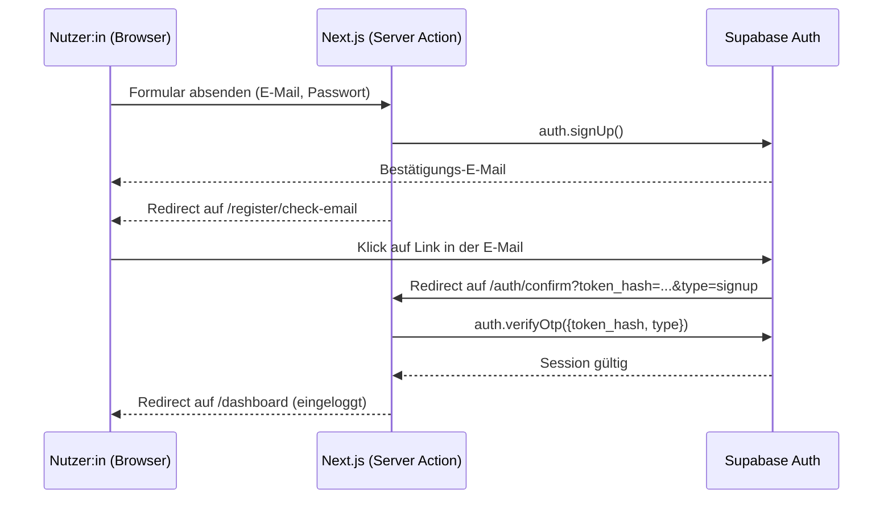

# Authentifizierung (Registrierung, Login, E-Mail-Bestätigung)

Dokumentiert, wie Login/Registrierung technisch funktionieren – als Grundlage für die technische Dokumentation (MS 4) und damit nachvollziehbar ist, warum der Code so aussieht, wie er aussieht.

## 1. Überblick

Authentifizierung läuft komplett über **Supabase Auth**, nicht über selbst geschriebenen Passwort-Code (siehe Begründung in der Projektkonfiguration, Abschnitt "Lösungsansatz"). Next.js spricht Supabase über `@supabase/ssr` an, das die Session in Cookies hält – dadurch funktioniert der Login sowohl in Server Components als auch in Route Handlern.

## 2. Beteiligte Dateien

| Datei | Zweck |
| --- | --- |
| `src/lib/supabase/client.ts` | Supabase-Client für Client Components (Browser) |
| `src/lib/supabase/server.ts` | Supabase-Client für Server Components/Actions (liest/schreibt Cookies) |
| `src/proxy.ts` | Hält die Session bei jedem Request aktuell (Next.js "Proxy", früher "Middleware") |
| `src/app/register/page.tsx` + `actions.ts` | Registrierungsformular + `signUp()`-Aufruf |
| `src/app/register/check-email/page.tsx` | Hinweis-Seite nach erfolgreicher Registrierung |
| `src/app/login/page.tsx` + `actions.ts` | Login-Formular + `signInWithPassword()`-Aufruf |
| `src/app/auth/confirm/route.ts` | Ziel des Bestätigungslinks aus der E-Mail |
| `src/app/dashboard/page.tsx` + `actions.ts` | Geschützte Beispielseite (Nachweis: Login funktioniert) + Logout |

## 3. Ablauf Registrierung → Bestätigung → eingeloggt



**Wichtig:** Der Link in der E-Mail zeigt zuerst auf Supabase selbst (`.../auth/v1/verify?token=...`), nicht direkt auf unsere Route. Supabase prüft den Token serverseitig und leitet erst danach auf unsere `redirect_to`-URL (`/auth/confirm`) weiter – mit `token_hash` und `type` als Query-Parametern bei Erfolg, oder mit `error`/`error_code` bei einem ungültigen/abgelaufenen Link. Unsere Route behandelt beide Fälle (siehe `route.ts`).

## 4. Next.js 16 "Cache Components" – warum `export const instant = false`

Next.js 16 versucht standardmäßig, möglichst viel einer Seite vorab zu rendern ("Static Shell"). Seiten, die `cookies()` lesen (jede Seite, die die Session prüft) oder `searchParams` auswerten (z. B. Fehlermeldungen nach einem Redirect), können das nicht – der Build bricht sonst mit einem Fehler ab ("uncached or runtime data during prerendering").

Next.js bietet dafür drei Lösungswege; wir nutzen aktuell den einfachsten (empfohlen für den Einstieg/die Migration laut Next.js-eigener Doku zu "Authentication with Cache Components"):

```ts
export const instant = false;
```

Das markiert die Seite als bewusst dynamisch/serverseitig gerendert – für `login`, `register` und `dashboard` genutzt. Der fortgeschrittenere Weg (`<Suspense>` + `"use cache: private"`, siehe Next.js-Doku) würde die Navigation noch etwas beschleunigen, ist für den aktuellen Projektumfang aber nicht nötig.

## 5. Bekannte Einschränkung: E-Mail-Rate-Limit (Supabase Free Tier)

Der kostenlose Supabase-Plan limitiert, wie viele Auth-E-Mails (Bestätigung, Passwort-Reset etc.) pro Zeitraum verschickt werden dürfen. Beim Testen erscheint dann die Fehlermeldung "email rate limit exceeded" auf der Registrierungsseite (wird korrekt angezeigt, kein Bug). Relevant für:

- **Testen im Team:** Nicht in kurzer Folge viele Test-Accounts anlegen.
- **Live-Demo/Video (MS 5):** Vorher einmal kurz testen, ob das Limit gerade nicht ausgeschöpft ist, oder einen bereits bestätigten Test-Account vorbereiten.

## 6. Verifiziert (manuell, 2026-10-22)

- Registrierung mit gültiger Test-Adresse → Bestätigungs-Mail kommt an (Absender `noreply@mail.app.supabase.io`)
- Ungültige/bekannte Test-Domain (`@example.com`) → Supabase lehnt ab, Fehlermeldung wird korrekt angezeigt
- Rate Limit greift nach mehreren Registrierungen kurz hintereinander → Fehlermeldung wird korrekt angezeigt
- `npm run build` und `npm run lint` laufen ohne Fehler durch
- Noch **nicht** automatisiert getestet: der komplette Klick-Durchlauf bis `/dashboard` (durch eine Browser-Policy beim Testen blockiert) – die Redirect-Logik ist aber serverseitig über die Supabase-Antwort-Header verifiziert (`Location: http://localhost:3000/auth/confirm?...`). Empfehlung: einmal manuell im eigenen Browser durchklicken, um den letzten Schritt visuell zu bestätigen.
