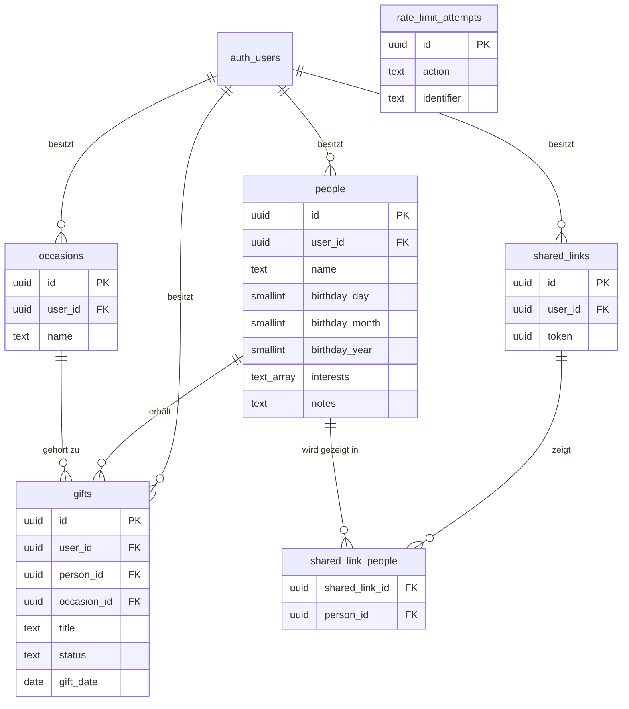

# Datenbank-Schema

Dokumentiert das Schema aus [`supabase/migrations/20261022200000_initial_schema.sql`](../supabase/migrations/20261022200000_initial_schema.sql), [`supabase/migrations/20261029210000_people_birthday_interests_sharing.sql`](../supabase/migrations/20261029210000_people_birthday_interests_sharing.sql) und [`supabase/migrations/20261030130000_rate_limit_attempts.sql`](../supabase/migrations/20261030130000_rate_limit_attempts.sql). Diese Datei ist als Grundlage für die technische Dokumentation (MS 3/MS 4) gedacht: sie erklärt nicht nur *was* angelegt wurde, sondern auch *warum*.

## 1. Überblick

Fünf Tabellen pro Nutzer:in (direkt oder über eine Elterntabelle über `user_id` an `auth.users` gebunden, von Supabase Auth verwaltet), plus eine sechste ohne Nutzer:innen-Bezug für das Rate-Limiting (QA5):

- **people** – Personen, denen Geschenke gemacht werden
- **occasions** – Anlässe (Weihnachten, Geburtstag, frei erstellbar)
- **gifts** – Geschenkideen *und* bereits gegebene Geschenke (ein Datensatz durchläuft beide Zustände)
- **shared_links** – ein per Link geteilter Satz Personen (A10)
- **shared_link_people** – welche Personen ein Link zeigt (n:m)
- **rate_limit_attempts** – zählt Login-/Registrierungsversuche je E-Mail (QA5), bewusst ohne `user_id` - läuft vor dem Login

`rate_limit_attempts` hat bewusst keine Beziehung im Diagramm - sie zählt Versuche je E-Mail-Adresse, unabhängig davon, ob dazu überhaupt ein Account existiert.

## 2. Entitäten im Detail

### `people`

| Spalte | Typ | Beschreibung |
| --- | --- | --- |
| `id` | uuid | Primärschlüssel |
| `user_id` | uuid | Besitzer:in (FK auf `auth.users`) |
| `name` | text | Name der Person |
| `birthday_day` / `birthday_month` | smallint | Tag/Monat des Geburtstags, zusammen Pflicht sobald einer gesetzt wird |
| `birthday_year` | smallint | Geburtsjahr, optional (Datensparsamkeit, A1/QA7) |
| `interests` | text[] | Interessen als freie Tags, Grundlage für Vorschläge (A12) |
| `notes` | text | Freitext, "weitere Infos zur Person" |
| `created_at` / `updated_at` | timestamptz | Zeitstempel |

**Entscheidung Geburtstag:** `date` kann kein "Jahr optional" abbilden (ein SQL-`date` braucht immer ein Jahr). Deshalb drei Spalten statt einer; `birthday_day`/`birthday_month` sind über einen Check-Constraint an eine gemeinsame Pflicht gekoppelt (beide gesetzt oder beide `null`), `birthday_year` bleibt unabhängig nullable.

### `occasions`

| Spalte | Typ | Beschreibung |
| --- | --- | --- |
| `id` | uuid | Primärschlüssel |
| `user_id` | uuid | Besitzer:in |
| `name` | text | z. B. "Weihnachten", "Geburtstag", oder frei benannt |

**Entscheidung:** Anlässe sind pro Nutzer:in global (nicht pro Person), weil "Weihnachten" für alle Personen gleichzeitig gilt. "Weihnachten" und "Geburtstag" werden automatisch bei Registrierung angelegt (siehe Abschnitt 4), zusätzliche Anlässe kann man frei hinzufügen.

### `gifts`

| Spalte | Typ | Beschreibung |
| --- | --- | --- |
| `id` | uuid | Primärschlüssel |
| `user_id` | uuid | Besitzer:in |
| `person_id` | uuid | Für wen (FK `people`) |
| `occasion_id` | uuid | Zu welchem Anlass (FK `occasions`, nullable) |
| `title` | text | Kurzbezeichnung der Idee/des Geschenks |
| `description` | text | Freitext-Notiz |
| `link` | text | Link zur Idee (z. B. Produktseite) |
| `image_url` | text | Verweis auf Bild in Supabase Storage |
| `status` | text | `idea` (= "offen") \| `purchased` (= "besorgt") \| `given` (= "überreicht", Stufe 2/A9) |
| `gift_date` | date | Datum (geplant oder tatsächlich überreicht) |

**Entscheidung:** Eine Tabelle statt getrennter Tabellen für "Ideen" und "Geschenke". Begründung: laut Themenbeschreibung soll eine Idee einfach in ein Geschenk "umwandelbar" sein – mit einer gemeinsamen Tabelle ist das ein reines Update (`status` ändern, `occasion_id`/`gift_date` setzen) statt eines Datensatz-Transfers zwischen zwei Tabellen. Das vereinfacht auch die geforderte "gemeinsame Ansicht: vergangene Geschenke + Ideen je Person" – ein einziges `select ... where person_id = ...` liefert beides, gefiltert über `status`.

**`open_tasks` (Freitext) wurde wieder entfernt:** A4 verlangt für Stufe 3 eine *strukturierte, abhakbare* Aufgabenliste mit Zähler (z. B. "1/2 erledigt"), kein Freitextfeld. Kommt als eigene Tabelle (`gift_tasks` o. ä.) mit Stufe 3.

### `shared_links` / `shared_link_people`

| Tabelle | Spalte | Typ | Beschreibung |
| --- | --- | --- | --- |
| `shared_links` | `id` | uuid | Primärschlüssel |
| `shared_links` | `user_id` | uuid | Besitzer:in |
| `shared_links` | `token` | uuid | Nicht erratbarer öffentlicher Teil der URL (`/teilen/<token>`) |
| `shared_link_people` | `shared_link_id` | uuid | FK auf `shared_links` |
| `shared_link_people` | `person_id` | uuid | FK auf `people` |

**Entscheidung:** Ein Link kann laut Wireframe mehrere Personen zeigen, und man kann mehrere Links gleichzeitig haben (einzeln widerrufbar) – deshalb zwei Tabellen (1 Link : n Personen) statt eines einzelnen `share_token` pro Person. "Widerrufen" = Zeile in `shared_links` löschen (Cascade löscht die Zuordnungen mit).

**Zugriff ohne Login:** Läuft bewusst nicht über RLS (siehe Abschnitt 3), sondern über eine serverseitige Route mit dem Service-Role-Key, die den Token explizit prüft und nur die zugeordneten Personen/Ideen zurückgibt.

### `rate_limit_attempts`

| Spalte | Typ | Beschreibung |
| --- | --- | --- |
| `id` | uuid | Primärschlüssel |
| `action` | text | `login` \| `register` (`reset` kommt mit der Passwort-Reset-Funktion, Stufe 2, dazu) |
| `identifier` | text | E-Mail-Adresse, klein geschrieben |
| `created_at` | timestamptz | Zeitpunkt des Versuchs |

**Entscheidung (QA5 – "begrenzte Versuche bei Login, Registrierung und Reset"):** Zählt Versuche je E-Mail in einem 15-Minuten-Fenster (max. 5), ab dem sechsten Versuch wird blockiert. Bei Login zählen nur fehlgeschlagene Versuche (ein erfolgreicher Login darf nie selbst dazu führen, dass man ausgesperrt wird); bei der Registrierung zählt jeder Versuch, weil jeder `signUp()`-Aufruf eine Bestätigungs-Mail auslöst und wiederholte Versuche für dieselbe Adresse sonst Supabases eigenes Mail-Ratenlimit treffen würden (genau das Problem, das uns beim Live-Testen mehrfach ausgebremst hat). Alte Zeilen (älter als 24 h) werden bei jedem neuen Eintrag mit aufgeräumt, statt einen eigenen Cron-Job dafür zu brauchen.

**Zugriff:** Läuft vor dem Login, also ohne `auth.uid()` – RLS ist aktiviert, aber bewusst ohne Policies (Default-Deny), nur der serverseitige Service-Role-Client (`src/lib/rate-limit.ts`) kommt dran.

## 3. Sicherheitskonzept: Row Level Security (RLS)

Alle fünf nutzer:innen-gebundenen Tabellen haben RLS aktiviert, mit Policies der Form `auth.uid() = user_id` (bei `shared_link_people` über einen Join auf `shared_links.user_id`) für select/insert/update/delete. `rate_limit_attempts` hat RLS ohne Policies (siehe oben). Das bedeutet konkret:

- Die Datenbank selbst erzwingt die Trennung der Nutzer:innen-Daten – nicht nur der Anwendungscode.
- Selbst wenn im Frontend ein Fehler passiert (z. B. eine falsche Filterbedingung vergessen), kann ein:e Nutzer:in nie fremde Daten sehen oder verändern.
- Relevant für die Qualitätsplanung (MS 3, "Maßnahmen zur Berücksichtigung von IT-Sicherheit und Datenschutz") – RLS ist die von Supabase empfohlene Standard-Absicherung für genau dieses Szenario (mehrere Nutzer:innen, gemeinsame Tabellen).

Zugriff über den **Publishable Key** (clientseitig) ist damit sicher, weil RLS greift. Der **Secret Key** (umgeht RLS vollständig) wird ausschließlich serverseitig für die öffentliche Teilen-Route verwendet (siehe `shared_links` oben) – RLS kann "gehört dieser Token zu dieser Zeile" für anonyme, nicht eingeloggte Zugriffe nicht sauber abbilden, ohne den Token clientseitig als Session-Variable zu übergeben. Der Token selbst ist dabei das Zugriffsrecht (nicht erratbar, 122 Bit Zufall), die Route prüft ihn explizit und gibt gezielt nur die zugeordneten Personen/Ideen zurück.

**Setup:** Der Secret Key muss als `SUPABASE_SERVICE_ROLE_KEY` in `.env.local` (lokal) und in den Vercel-Umgebungsvariablen (alle drei Umgebungen) hinterlegt werden – zu finden im Supabase-Dashboard unter Project Settings → API → `service_role`-Key. Ohne diese Variable schlägt nur die Teilen-Route (`/teilen/<token>`) fehl, alles andere funktioniert weiter normal über den Publishable Key.

**Session-Cookie (QA5 – "Sitzungs-Cookie mit HttpOnly, Secure und SameSite"):** `src/lib/supabase/server.ts` setzt `cookieOptions: { httpOnly: true, secure: true }` explizit. `@supabase/ssr` setzt standardmäßig `httpOnly: false` (für den Browser-Client gedacht, der clientseitig per JavaScript auf die Session zugreifen soll) – dieses Projekt nutzt den Browser-Client aber nirgends, jede Auth-Aktion läuft über Server Actions, daher ist HttpOnly hier sicher und sinnvoll. `sameSite: "lax"` ist bereits der Default und schützt vor CSRF, ohne externe Navigation (z. B. E-Mail-Bestätigungslinks) zu blockieren – Next.js' Server Actions prüfen zusätzlich automatisch den `Origin`-Header gegen den `Host`-Header (CSRF-Schutz ohne eigenen Code).

## 4. Automatisierung (Trigger)

Zwei Datenbank-Trigger:

1. `set_updated_at` – setzt `updated_at` automatisch bei jedem Update (auf `people` und `gifts`), damit das nie vergessen wird.
2. `handle_new_user` – legt bei jeder neuen Registrierung (`auth.users`-Insert) automatisch die Anlässe "Weihnachten" und "Geburtstag" für diese:n Nutzer:in an.

## 5. Abdeckung der funktionalen Anforderungen

| Anforderung (aus der Themenbeschreibung) | Umsetzung im Schema |
| --- | --- |
| Personen mit Geburtstag (Jahr optional), Tags, Notiz (A1) | `people.birthday_day/_month/_year`, `people.interests`, `people.notes` |
| Dokumentation vergangener Geschenke je Person (A2, Stufe 2) | `gifts` mit `status = 'given'`, gefiltert nach `person_id` |
| Feste + frei erstellbare Anlässe (A3) | `occasions`, automatisch vorbelegt + frei erweiterbar |
| Geschenkideen mit Anlass + Status (A4, MVP-Teil) | `gifts.occasion_id`, `gifts.status` |
| Abhakbare Aufgaben je Idee (A4, Stufe 3) | *noch nicht im Schema* – eigene Tabelle folgt mit Stufe 3 |
| Gemeinsame Ansicht Geschenke + Ideen je Person (A5) | ein `gifts`-Select nach `person_id`, `status` unterscheidet |
| Schnelles Speichern Text + Link (A8, MVP-Teil) | `gifts.title`, `gifts.link` |
| Bild-Upload (A8, Stufe 3) | `gifts.image_url` vorbereitet, Storage-Bucket fehlt noch |
| Umwandlung Idee → Geschenk (A9, Stufe 2) | Update von `status`, `occasion_id`, `gift_date` |
| Teilen von Geschenkideen per Link, mehrere Personen/Links (A10, MVP) | `shared_links`, `shared_link_people` |
| Automatische Erinnerungen (A6/A7, Stufe 2) | *noch nicht Teil des Schemas* – wird über den geplanten Cron Job (Vercel) + Query auf `people.birthday_*`/`occasions` umgesetzt |
| Automatische Generierung weiterer Ideen (A12, Stufe 3) | *bewusst nicht im MVP-Schema* – spätere Erweiterung, siehe Abschnitt 6 |
| Begrenzte Versuche bei Login, Registrierung und Reset (QA5, MVP) | `rate_limit_attempts`; Reset folgt mit der Passwort-Reset-Funktion (Stufe 2) |

## 6. Bewusst nicht umgesetzt (für später)

- **Automatische Ideen-Generierung (A12, Stufe 3):** Keine eigene Tabelle/Logik im MVP. Erste sinnvolle Umsetzung: regelbasierter Vorschlag (z. B. "gleiche Tags wie bei früheren Geschenken dieser Person"), bewusst ohne KI-Anbindung (RB7).
- **Rate-Limiting für Passwort-Reset (QA5, Stufe 2):** Die Helper-Funktionen (`src/lib/rate-limit.ts`) unterstützen bereits eine `"reset"`-Action, sie wird aber erst mit der Passwort-Reset-Funktion selbst verdrahtet (aktuell nur Platzhalter unter `/passwort-vergessen`).
- **Bild-Uploads (A8, Stufe 3):** `gifts.image_url` ist vorbereitet, der Supabase-Storage-Bucket dafür muss noch angelegt werden.
- **Abhakbare Aufgaben je Idee (A4, Stufe 3):** Eigene Tabelle (z. B. `gift_tasks`) noch zu entwerfen.

## 7. Migrationen anwenden

Da noch keine Supabase-CLI im Projekt eingerichtet ist, läuft es manuell über das Dashboard:

1. Supabase-Dashboard öffnen → eigenes Projekt → **SQL Editor** (linke Sidebar)
2. "New query"
3. Inhalt der Migrationsdatei(en) **in Reihenfolge des Datums im Dateinamen** komplett einfügen (zuerst `20261022200000_...`, dann `20261029210000_...`)
4. **Run** klicken
5. Kontrolle: unter **Table Editor** sollten jetzt `people`, `occasions`, `gifts`, `shared_links`, `shared_link_people` auftauchen

Die Datei ist bewusst im Supabase-CLI-Namensformat (`YYYYMMDDHHMMSS_name.sql`) benannt – falls später die CLI eingerichtet wird, kann sie 1:1 mit `supabase db push` übernommen werden, ohne etwas umbenennen zu müssen.
