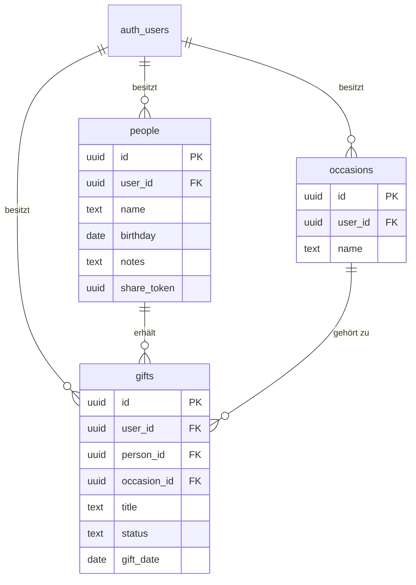

# Datenbank-Schema

Dokumentiert das initiale Schema aus [`supabase/migrations/20261022200000_initial_schema.sql`](../supabase/migrations/20261022200000_initial_schema.sql). Diese Datei ist als Grundlage für die technische Dokumentation (MS 3/MS 4) gedacht: sie erklärt nicht nur *was* angelegt wurde, sondern auch *warum*.

## 1. Überblick

Drei Tabellen, alle pro Nutzer:in über `user_id` an `auth.users` (von Supabase Auth verwaltet) gebunden:

- **people** – Personen, denen Geschenke gemacht werden
- **occasions** – Anlässe (Weihnachten, Geburtstag, frei erstellbar)
- **gifts** – Geschenkideen *und* bereits gegebene Geschenke (ein Datensatz durchläuft beide Zustände)

## 2. Entitäten im Detail

### `people`

| Spalte | Typ | Beschreibung |
| --- | --- | --- |
| `id` | uuid | Primärschlüssel |
| `user_id` | uuid | Besitzer:in (FK auf `auth.users`) |
| `name` | text | Name der Person |
| `birthday` | date | Geburtstag, Basis für Erinnerungen |
| `notes` | text | Freitext, "weitere Infos zur Person" |
| `share_token` | uuid | Öffentlicher Token zum Teilen der Geschenkideen dieser Person per Link |
| `created_at` / `updated_at` | timestamptz | Zeitstempel |

### `occasions`

| Spalte | Typ | Beschreibung |
| --- | --- | --- |
| `id` | uuid | Primärschlüssel |
| `user_id` | uuid | Besitzer:in |
| `name` | text | z. B. "Weihnachten", "Geburtstag", oder frei benannt |

**Entscheidung:** Anlässe sind pro Nutzer:in global (nicht pro Person), weil "Weihnachten" für alle Personen gleichzeitig gilt. "Weihnachten" und "Geburtstag" werden automatisch bei Registrierung angelegt (siehe Abschnitt 4), zusätzliche Anlässe kann man frei hinzufügen.

### `gifts`

| Spalte | Typ | Beschreibung |
| --- | --- | --- |
| `id` | uuid | Primärschlüssel |
| `user_id` | uuid | Besitzer:in |
| `person_id` | uuid | Für wen (FK `people`) |
| `occasion_id` | uuid | Zu welchem Anlass (FK `occasions`, nullable) |
| `title` | text | Kurzbezeichnung der Idee/des Geschenks |
| `description` | text | Freitext-Notiz |
| `link` | text | Link zur Idee (z. B. Produktseite) |
| `image_url` | text | Verweis auf Bild in Supabase Storage |
| `status` | text | `idea` \| `purchased` \| `given` |
| `open_tasks` | text | Offene Aufgaben (z. B. "noch bestellen") |
| `gift_date` | date | Datum (geplant oder tatsächlich überreicht) |

**Entscheidung:** Eine Tabelle statt getrennter Tabellen für "Ideen" und "Geschenke". Begründung: laut Themenbeschreibung soll eine Idee einfach in ein Geschenk "umwandelbar" sein – mit einer gemeinsamen Tabelle ist das ein reines Update (`status` ändern, `occasion_id`/`gift_date` setzen) statt eines Datensatz-Transfers zwischen zwei Tabellen. Das vereinfacht auch die geforderte "gemeinsame Ansicht: vergangene Geschenke + Ideen je Person" – ein einziges `select ... where person_id = ...` liefert beides, gefiltert über `status`.

## 3. Sicherheitskonzept: Row Level Security (RLS)

Alle drei Tabellen haben RLS aktiviert, mit Policies der Form `auth.uid() = user_id` für select/insert/update/delete. Das bedeutet konkret:

- Die Datenbank selbst erzwingt die Trennung der Nutzer:innen-Daten – nicht nur der Anwendungscode.
- Selbst wenn im Frontend ein Fehler passiert (z. B. eine falsche Filterbedingung vergessen), kann ein:e Nutzer:in nie fremde Daten sehen oder verändern.
- Relevant für die Qualitätsplanung (MS 3, "Maßnahmen zur Berücksichtigung von IT-Sicherheit und Datenschutz") – RLS ist die von Supabase empfohlene Standard-Absicherung für genau dieses Szenario (mehrere Nutzer:innen, gemeinsame Tabellen).

Zugriff über den **Publishable Key** (clientseitig) ist damit sicher, weil RLS greift. Der **Secret Key** (umgeht RLS vollständig) wird aktuell nirgends verwendet.

## 4. Automatisierung (Trigger)

Zwei Datenbank-Trigger:

1. `set_updated_at` – setzt `updated_at` automatisch bei jedem Update (auf `people` und `gifts`), damit das nie vergessen wird.
2. `handle_new_user` – legt bei jeder neuen Registrierung (`auth.users`-Insert) automatisch die Anlässe "Weihnachten" und "Geburtstag" für diese:n Nutzer:in an.

## 5. Abdeckung der funktionalen Anforderungen

| Anforderung (aus der Themenbeschreibung) | Umsetzung im Schema |
| --- | --- |
| Personenliste mit Geburtstagen + Infos | `people.birthday`, `people.notes` |
| Dokumentation vergangener Geschenke je Person | `gifts` mit `status = 'given'`, gefiltert nach `person_id` |
| Feste + frei erstellbare Anlässe | `occasions`, automatisch vorbelegt + frei erweiterbar |
| Geschenkideen mit Anlass, Status, offenen Aufgaben | `gifts.occasion_id`, `gifts.status`, `gifts.open_tasks` |
| Gemeinsame Ansicht Geschenke + Ideen je Person | ein `gifts`-Select nach `person_id`, `status` unterscheidet |
| Schnelles Speichern (Text, Links, Bilder) | `gifts.description`, `gifts.link`, `gifts.image_url` |
| Umwandlung Idee → Geschenk | Update von `status`, `occasion_id`, `gift_date` |
| Teilen von Geschenkideen per Link | `people.share_token` |
| Automatische Erinnerungen (Geburtstage, Weihnachten) | *noch nicht Teil des Schemas* – wird über den geplanten Cron Job (Vercel) + Query auf `people.birthday`/`occasions` umgesetzt, siehe Projektkonfiguration Abschnitt 4 |
| Automatische Generierung weiterer Ideen | *bewusst nicht im MVP-Schema* – spätere Erweiterung, siehe Abschnitt 6 |

## 6. Bewusst nicht umgesetzt (für später)

- **Automatische Ideen-Generierung:** Keine eigene Tabelle/Logik im MVP. Erste sinnvolle Umsetzung: regelbasierter Vorschlag (z. B. "gleiche Kategorie wie frühere Geschenke dieser Person"), bevor man über eine KI-Anbindung nachdenkt.
- **Teilen per Link – öffentlicher Lesezugriff:** `share_token` existiert schon in `people`, aber es gibt noch keine Route, die ihn öffentlich (ohne Login) auswertet. Geplante Umsetzung: eine serverseitige Next.js Route, die den Secret Key verwendet, um gezielt nur die Daten der passenden Person zurückzugeben (RLS bleibt für alle anderen Zugriffe aktiv) – kein öffentliches RLS-Policy-Loch nötig.
- **Bild-Uploads:** `gifts.image_url` ist vorbereitet, der Supabase-Storage-Bucket dafür muss noch angelegt werden.

## 7. Migration anwenden

Da noch keine Supabase-CLI im Projekt eingerichtet ist, läuft es manuell über das Dashboard:

1. Supabase-Dashboard öffnen → eigenes Projekt → **SQL Editor** (linke Sidebar)
2. "New query"
3. Inhalt von `supabase/migrations/20261022200000_initial_schema.sql` komplett einfügen
4. **Run** klicken
5. Kontrolle: unter **Table Editor** sollten jetzt `people`, `occasions`, `gifts` auftauchen

Die Datei ist bewusst im Supabase-CLI-Namensformat (`YYYYMMDDHHMMSS_name.sql`) benannt – falls später die CLI eingerichtet wird, kann sie 1:1 mit `supabase db push` übernommen werden, ohne etwas umbenennen zu müssen.
